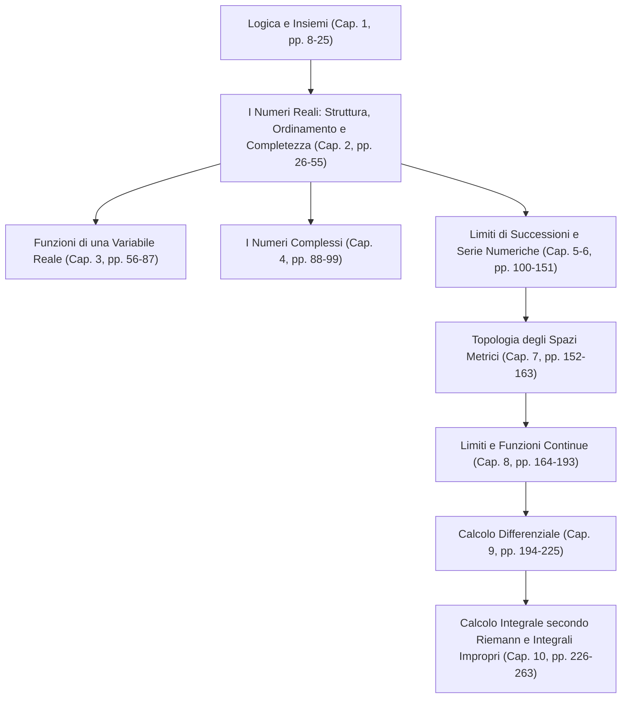

[[Home MOC|Home]] / [[University|University MOC]] / [[Analisi 1 MOC]] / [[Lezioni di Analisi 1]]

# Lezioni di Analisi 1

L'opera didattica curata da <mark style="background:rgba(181, 113, 255, 0.36)"><b>Elio Cabib</b></mark> (professore di Analisi Matematica presso l'Università di Udine) costituisce un trattato fondativo e rigoroso concepito per i [[Corsi]] di laurea scientifici ed ingegneristici \[[[Lezioni di Analisi 1.pdf#page=1|1]]], \[[[Lezioni di Analisi 1.pdf#page=2|2]]]. Il testo rifugge l'approccio nozionistico contemporaneo, strutturando il percorso conoscitivo secondo una progressione assiomatica e deduttiva che parte dai fondamenti della logica e della teoria degli insiemi, attraversa la costruzione dei sistemi numerici e degli spazi metrici, e culmina nello sviluppo sistematico del calcolo differenziale e integrale.

## Filosofia Didattica ed Epistemologia dell'Apprendimento

L'architettura del testo risponde a una precisa scelta metodologica: la matematica non può essere assimilata mediante ricezione passiva o memorizzazione superficiale di prontuari operativi, bensì richiede una rielaborazione concettuale autonoma \[[[Lezioni di Analisi 1.pdf#page=4|4]]]. L'esposizione alterna volutamente momenti di indagine intuitiva — modellati sulla dinamica maieutica della lezione frontale — a sistemazioni rigorose e formali.

> [!quote]- Divagazione del Docente: Rifiuto della didattica frammentata e libertà di apprendimento
> "Trattandosi di un testo elettronico a libera diffusione... è svincolato dalle pretese, sia grafiche, sia contrattuali, degli editori... Ma ha un pregio non irrilevante: non esistono 'note a margine', 'rubriche di approfondimento' o altre sciocchezze e smanie didattiche di moda oggi, come il riassuntino memorizzatore delle regolette appena spiegate, a mio avviso un ostacolo alla libertà di apprendimento da parte dello studente. È vero che non bisogna mettere tutto sullo stesso piano, che ci sono risultati centrali, fondamentali, e risultati minori, ma non sta al docente doverli distinguere sottolineando le prime e scrivendo 'in piccolo' le seconde... se si toglie l'opportunità allo studente di usare le sue capacità critiche e la libertà di personalizzare la materia... non gli resterà altro da fare se non cercare di imparare (per l'esame) invece di capire. E non è con la memorizzazione, passiva per sua natura, che si impara la Matematica." \[[[Lezioni di Analisi 1.pdf#page=4|4]]]

Il pilastro gnoseologico dell'opera poggia sul principio secondo cui lo sforzo interpretativo dello studente è condizione necessaria per cogliere la genesi di definizioni e teoremi.

<mark style="background:rgba(255, 193, 69, 0.32)"><b>Comprensione autonoma e pensiero critico</b></mark>: l'apprendimento autentico dell'analisi matematica richiede l'analisi genetica dei concetti e la ricostruzione del legame consequenziale tra premesse formali e proprietà emergenti, rifiutando scorciatoie mnemoniche strutturate o sintesi precotte.

> [!tip]- Flashcard: Epistemologia dell'Apprendimento Matematico
%%
TARGET DECK: University::Analisi_1
START
Basic
Front: Qual è la critica pedagogica rivolta da Elio Cabib ai manuali con rubriche di riassunto e note a margine?
Back: Ritiene che privino lo studente della libertà e della capacità critica di gerarchizzare autonomamente i contenuti tra risultati primari e secondari. Questa frammentazione induce una memorizzazione passiva orientata all'esame anziché una comprensione profonda delle motivazioni sottese a definizioni e teoremi.
Tags: Analisi_1::Epistemologia::Metodologia
<!--ID: 1790022279298-->
END
%%

---

## Architettura Logica e Propedeutica Strutturale

L'opera si sviluppa lungo un'articolazione in dieci capitoli tematici coerentemente concatenati, delineando una traiettoria che muove dalla sintassi formale del linguaggio matematico fino alla misura e all'integrazione \[[[Lezioni di Analisi 1.pdf#page=8|8]]], \[[[Lezioni di Analisi 1.pdf#page=226|226]]].

### 1. Logica Matematica, Relazioni e Insiemi
Il capitolo introduttivo definisce i mattoni del rigore: calcolo proposizionale, predicati quantificati, principi di deduzione e dimostrazione (per assurdo, induzione), insiemistica classica, prodotto cartesiano, relazioni d'equivalenza, relazioni d'ordine e nozione generale di applicazione/funzione \[[[Lezioni di Analisi 1.pdf#page=8|8]]], \[[[Lezioni di Analisi 1.pdf#page=15|15]]].

### 2. Il Campo Reale e la Completezza
La trattazione costruisce il sistema numerico reale $\mathbb{R}$ su tre pilastri:
1. Struttura algebrica di <mark style="background:rgba(181, 113, 255, 0.36)"><b>campo</b></mark> commutativo;
2. <mark style="background:rgba(181, 113, 255, 0.36)"><b>ordinamento totale</b></mark> compatibile con le operazioni algebriche;
3. Assioma di <mark style="background:rgba(255, 193, 69, 0.32)"><b>completezza di Dedekind</b></mark> (esistenza dell'estremo superiore) \[[[Lezioni di Analisi 1.pdf#page=30|30]]].

> [!info] Principio / Definizione: Assioma di Completezza di Dedekind
> $$S \subseteq \mathbb{R},\; S \neq \emptyset,\; \exists M \in \mathbb{R} : \forall x \in S,\; x \le M \implies \exists \sup S \in \mathbb{R}$$
> - **Ipotesi:** Un sottoinsieme $S$ non vuoto della retta reale $\mathbb{R}$ superiormente limitato.
> - **Condizioni di validità:** Richiede un campo totalmente ordinato archimedeo; distingue strutturalmente $\mathbb{R}$ da $\mathbb{Q}$.
> - **Significato dei simboli:**
>   - $S$: sottoinsieme di elementi di $\mathbb{R}$ $[\text{adimensionale}]$
>   - $M$: maggiorante di $S$ $[\text{adimensionale}]$
>   - $\sup S$: estremo superiore (minimo dei maggioranti) $[\text{adimensionale}]$
> - **Esempio operativo:** L'insieme $S = \{q \in \mathbb{Q} : q^2 < 2\}$ non ammette estremo superiore in $\mathbb{Q}$, ma ammette $\sup S = \sqrt{2} \in \mathbb{R}$. \[[[Lezioni di Analisi 1.pdf#page=30|30]]]

> [!tip]- Flashcard: Assioma di Completezza in R
%%
TARGET DECK: University::Analisi_1
START
Cloze
Text: L'assioma di completezza sancisce che ogni sottoinsieme {{c1::non vuoto e limitato superiormente}} di $\mathbb{R}$ ammette {{c2::estremo superiore}} appartenente a $\mathbb{R}$.
Extra: Questa proprietà garantisce l'assenza di 'buchi' sulla retta reale ed è la linea di demarcazione fondamentale rispetto al campo dei razionali $\mathbb{Q}$.
Tags: Analisi_1::NumeriReali::Completezza
<!--ID: 1790022279301-->
END
%%

La sezione affronta inoltre la struttura metrica indotta dal valore assoluto, le proprietà dei numeri naturali $\mathbb{N}$, la combinatoria finita, il campo razionale $\mathbb{Q}$, la teoria della cardinalità e l'equipotenza (numerabilità di $\mathbb{Q}$, non numerabilità del continuo $\mathbb{R}$) \[[[Lezioni di Analisi 1.pdf#page=33|33]]], \[[[Lezioni di Analisi 1.pdf#page=50|50]]].

### 3. Anatomia delle Funzioni Reali di una Variabile Reale
Studio geometrico e algebrico delle funzioni elementari e delle loro classi \[[[Lezioni di Analisi 1.pdf#page=56|56]]]:
- Funzioni limitate, estremi assoluti e relativi \[[[Lezioni di Analisi 1.pdf#page=66|66]]];
- Monotonia stretta e debole, convessità e concavità \[[[Lezioni di Analisi 1.pdf#page=68|68]]], \[[[Lezioni di Analisi 1.pdf#page=70|70]]];
- Funzioni potenza, polinomiali, razionali fratte, irrazionali algebriche \[[[Lezioni di Analisi 1.pdf#page=74|74]]];
- Trascendenti elementari: esponenziali, logaritmi, funzioni trigonometriche, inverse trigonometriche e funzioni iperboliche \[[[Lezioni di Analisi 1.pdf#page=80|80]]], \[[[Lezioni di Analisi 1.pdf#page=84|84]]].

### 4. Estensione al Campo Complesso
Costruzione algebrica di $\mathbb{C}$ come spazio vettoriale bidimensionale dotato di moltiplicazione conforme, modulo, coniugio, rappresentazione trigonometrica/polare, formula di De Moivre, calcolo delle radici $n$-esime dell'unità e teorema fondamentale dell'algebra \[[[Lezioni di Analisi 1.pdf#page=88|88]]], \[[[Lezioni di Analisi 1.pdf#page=94|94]]].

---

## Processi di Limite, Convergenza e Topologia Metrica

La convergenza costituisce il cuore propulsore dell'analisi infinitesimale, sviluppata attraverso successioni, serie e la cornice astratta della topologia metrica \[[[Lezioni di Analisi 1.pdf#page=100|100]]], \[[[Lezioni di Analisi 1.pdf#page=152|152]]].

### 5. Limiti di Successioni Numeriche
Lo studio delle successioni definisce il comportamento asintotico discreto $n \to \infty$ \[[[Lezioni di Analisi 1.pdf#page=100|100]]]. Vengono formalizzati i teoremi di unicità del limite, permanenza del segno, teoremi di confronto (teorema dei carabinieri), convergenza monotona e la caratterizzazione del numero di Nepero $e$ \[[[Lezioni di Analisi 1.pdf#page=108|108]]]:

$$e = \lim_{n \to +\infty} \left(1 + \frac{1}{n}\right)^n$$

Completano il capitolo le successioni di medie (Cesàro), i punti limite, e il legame con l'esponenziale complesso tramite le formule di Eulero \[[[Lezioni di Analisi 1.pdf#page=119|119]]].

### 6. Teoria delle Serie Numeriche
Formalizzate come limite della successione delle somme parziali \[[[Lezioni di Analisi 1.pdf#page=126|126]]]:

$$S_k = \sum_{n=0}^k a_n, \quad S = \lim_{k \to +\infty} S_k$$

Lo studio distingue:
- <mark style="background:rgba(181, 113, 255, 0.36)"><b>Serie a termini non negativi</b></mark>: criteri del confronto ordinario, asintotico, del rapporto (d'Alembert), della radice (Cauchy), di condensazione di Cauchy \[[[Lezioni di Analisi 1.pdf#page=133|133]]];
- <mark style="background:rgba(181, 113, 255, 0.36)"><b>Serie a segno variabile</b></mark>: criterio di Leibniz per le serie alternate \[[[Lezioni di Analisi 1.pdf#page=139|139]]];
- <mark style="background:rgba(255, 193, 69, 0.32)"><b>Convergenza assoluta</b></mark>: $\sum |a_n| < +\infty \implies \sum a_n \text{ converge}$;
- Serie di potenze nel campo reale e complesso, raggio di convergenza (formula di Cauchy-Hadamard) \[[[Lezioni di Analisi 1.pdf#page=145|145]]].

> [!tip]- Flashcard: Convergenza Assoluta e Semplice
%%
TARGET DECK: University::Analisi_1
START
Basic
Front: Qual è la relazione logica tra convergenza assoluta e convergenza semplice per una serie numerica in $\mathbb{R}$ o $\mathbb{C}$?
Back: La convergenza assoluta implica sempre la convergenza semplice ($\sum |a_n| < +\infty \implies \sum a_n \text{ converge}$), mentre l'implicazione inversa non sussiste in generale (condizionatamente convergente, es. serie armonica alternata).
Tags: Analisi_1::SerieNumeriche::Convergenza
<!--ID: 1790022279302-->
END
%%

### 7. Spazi Metrici e Topologia
Generalizzazione geometrica indispensabile per ambientare la continuità e la convergenza \[[[Lezioni di Analisi 1.pdf#page=152|152]]]:
- Spazio metrico $(X, d)$, intorni sferici (palle aperte), aperti, chiusi, punti di accumulazione \[[[Lezioni di Analisi 1.pdf#page=153|153]]];
- Compattezza sequenziale e teorema di Heine-Borel (in $\mathbb{R}^n$: compatto $\iff$ chiuso e limitato) \[[[Lezioni di Analisi 1.pdf#page=160|160]]];
- Completezza metrica (successioni di Cauchy convergenti nello spazio) \[[[Lezioni di Analisi 1.pdf#page=162|162]]].

---

## Continuità, Calcolo Differenziale e Calcolo Integrale

### 8. Limiti di Funzioni e Funzioni Continue
Estensione della topologia metrica al comportamento locale e all'infinito delle funzioni \[[[Lezioni di Analisi 1.pdf#page=164|164]]]. Analisi comparativa tra infinitesimi e infiniti (simboli di Landau, principio di sostituzione), asintoti lineari e teoremi globali sulle funzioni continue definite su intervalli e insiemi compatti:
- **Teorema di Weierstraß**: esistenza di massimo e minimo assoluti su compatti \[[[Lezioni di Analisi 1.pdf#page=187|187]]];
- **Teorema degli zeri e dei valori intermedi** (connessione topologica) \[[[Lezioni di Analisi 1.pdf#page=184|184]]];
- **Uniforme continuità** e teorema di Heine-Cantor \[[[Lezioni di Analisi 1.pdf#page=191|191]]].

### 9. Il Calcolo Differenziale
Il calcolo differenziale traduce la variazione locale in approssimazione lineare mediante l'operatore di derivata \[[[Lezioni di Analisi 1.pdf#page=194|194]]]:

$$f'(x_0) = \lim_{x \to x_0} \frac{f(x) - f(x_0)}{x - x_0}$$

> [!example] Teorema / Legge: Teorema del Valor Medio di Lagrange
> $$f(b) - f(a) = f'(\xi)(b - a)$$
> - **Ipotesi:** 
>   1. $f : [a, b] \to \mathbb{R}$ continua in $[a, b]$;
>   2. $f$ derivabile in $(a, b)$.
> - **Condizioni di validità:** Intervallo limitato e chiuso; la differenziabilità può mancare agli estremi ma deve sussistere in ogni punto interno.
> - **Significato dei simboli:**
>   - $a, b$: estremi dell'intervallo reale $[\text{adimensionale}]$
>   - $f(a), f(b)$: valori della funzione agli estremi $[\text{adimensionale}]$
>   - $\xi$: punto stazionario/intermedio appartenente a $(a, b)$ $[\text{adimensionale}]$
>   - $f'(\xi)$: derivata prima valutata in $\xi$ $[\text{adimensionale}]$
> - **Esempio operativo:** Se la posizione di un corpo varia con $s(t)$, esiste un istante $\tau \in (t_1, t_2)$ in cui la velocità istantanea $s'(\tau)$ coincide con la velocità media $\frac{s(t_2)-s(t_1)}{t_2-t_1}$. \[[[Lezioni di Analisi 1.pdf#page=206|206]]]

> [!tip]- Flashcard: Teorema di Lagrange
%%
TARGET DECK: University::Analisi_1
START
Cloze
Text: Sotto le ipotesi di continuità in {{c1::$[a, b]$}} e derivabilità in {{c2::$(a, b)$}}, esiste almeno un punto $\xi \in (a, b)$ tale che {{c3::$f(b) - f(a) = f^\prime(\xi)(b - a)$}}.
Extra: Il teorema sancisce l'uguaglianza tra il coefficiente angolare della secante passante per gli estremi e la retta tangente al grafico nel punto intermedio $\xi$.
Tags: Analisi_1::Differenziale::Lagrange
<!--ID: 1790022279304-->
END
%%

Il capitolo si completa con:
- Teoremi di Rolle, Cauchy e regole di De L'Hôpital \[[[Lezioni di Analisi 1.pdf#page=204|204]]], \[[[Lezioni di Analisi 1.pdf#page=210|210]]];
- Formula di Taylor con resto di Peano e di Lagrange \[[[Lezioni di Analisi 1.pdf#page=212|212]]];
- Algoritmi di approssimazione numerica (metodo delle corde, metodo delle tangenti di Newton-Raphson) \[[[Lezioni di Analisi 1.pdf#page=216|216]]];
- Analisi qualitativa globale del grafico e classe delle funzioni analitiche $C^\omega$ \[[[Lezioni di Analisi 1.pdf#page=219|219]]].

### 10. Calcolo Integrale di Riemann e Forme Differenziali Primitive
L'opera approda alla teoria della misura e dell'integrazione secondo Riemann \[[[Lezioni di Analisi 1.pdf#page=226|226]]]:
1. Integrazione su funzioni costanti a tratti ed estensione per funzioni limitate su intervalli compatti tramite somme inferiori e superiori di Darboux \[[[Lezioni di Analisi 1.pdf#page=229|229]]], \[[[Lezioni di Analisi 1.pdf#page=231|231]]];
2. Caratterizzazione delle classi integrabili (funzioni continue, funzioni monotone a tratti) \[[[Lezioni di Analisi 1.pdf#page=233|233]]];
3. Proprietà di linearità, monotonia e additività rispetto all'intervallo \[[[Lezioni di Analisi 1.pdf#page=236|236]]];
4. Studio della funzione integrale e dimostrazione del teorema fondamentale del calcolo integrale (Torricelli-Barrow) \[[[Lezioni di Analisi 1.pdf#page=241|241]]];
5. Teoria degli integrali impropri (criteri di convergenza per confronto asintotico su domini non limitati o con singolarità) \[[[Lezioni di Analisi 1.pdf#page=245|245]]];
6. Metodologie di integrazione indefinita (per parti, per sostituzione, integrazione delle funzioni razionali fratte) \[[[Lezioni di Analisi 1.pdf#page=254|254]]].

---

## Quadro Sinottico delle Macro-Aree Concettuali

| Dominio Matematico | Strutture Cardine | Concetti Primi Operativi | Risultati Fondamentali | Riferimento PDF |
| :--- | :--- | :--- | :--- | :--- |
| **Fondamenti & Reali** | Insiemi, $(\mathbb{R}, +, \cdot, \le)$ | Relazioni, cardinalità, estremo superiore | Completezza di Dedekind, densità di $\mathbb{Q}$ in $\mathbb{R}$ | pp. 8–55 |
| **Spazi Metrici & Limiti** | Spazio metrico $(X, d)$, topologia euclidea | Intorni sferici, chiusura, compattezza, convergenza | Heine-Borel, Bolzano-Weierstrass, completezza | pp. 100–163 |
| **Calcolo Differenziale** | Spazio $C^k(I)$, derivata, differenziale | Rapporto incrementale, asintotismo locale ($o$-piccolo) | Teoremi di Rolle, Lagrange, Cauchy; formula di Taylor | pp. 194–225 |
| **Calcolo Integrale** | Integrabilità Riemann $\mathcal{R}[a,b]$ | Partizioni, somme di Darboux, funzione integrale | Teorema fondamentale del calcolo infinitesimale | pp. 226–263 |
